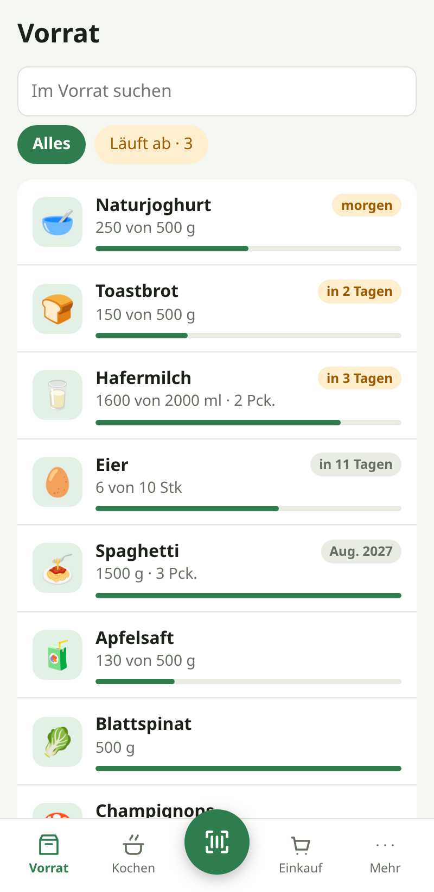
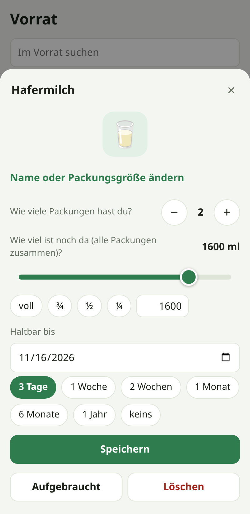
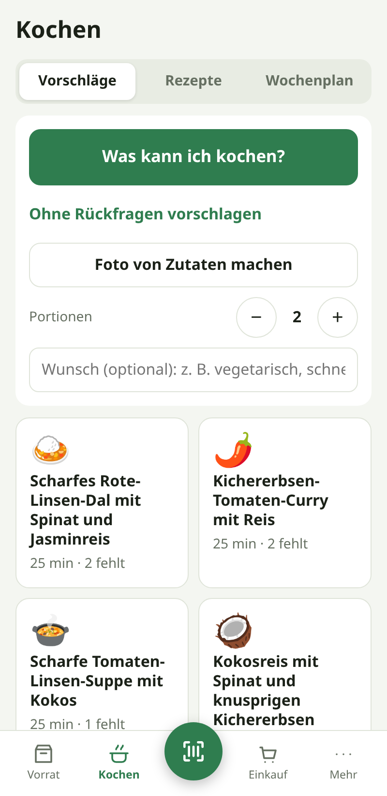
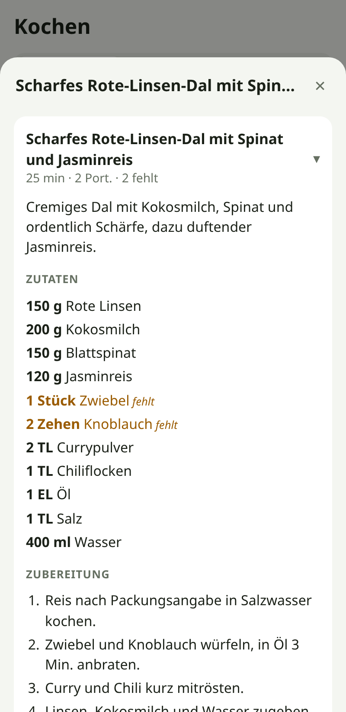
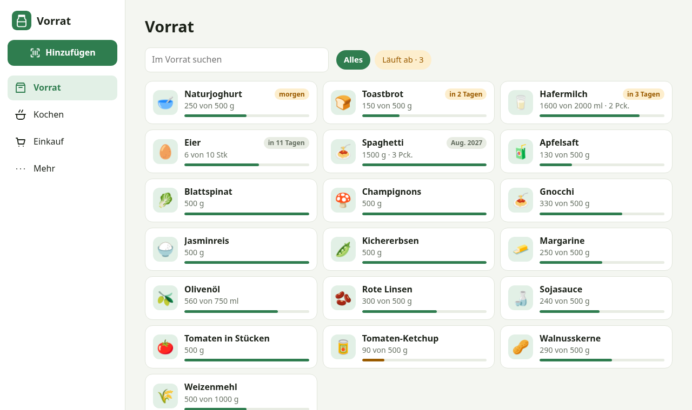

# Vorrat

Selbst gehostetes Lebensmittel-Inventar für den Haushalt: Barcode scannen, Füllstand und Ablaufdatum festhalten, rechtzeitig erinnert werden und sich von Claude Gerichte aus dem vorschlagen lassen, was da ist.

*Self-hosted pantry inventory with barcode scanning, expiry reminders, recipes, meal planning via Claude and shopping lists. The interface is German only.*

<p>
  
  
  
  
</p>



## Funktionen

- **Vorrat:** Barcode-Scan mit der Handykamera (Erkennung läuft auf dem Gerät), Produktdaten von [Open Food Facts](https://world.openfoodfacts.org), Füllstand pro Packung, Anzahl Packungen, Ablaufdatum
- **Erinnerungen:** tägliche Benachrichtigung, wenn etwas bald abläuft (Web-Push oder lokal in der Android-App)
- **Kochen mit Claude:** 6 Vorschläge aus dem Vorrat, wahlweise mit kurzen Rückfragen zum Antippen oder aus einem Foto der Zutaten; Wochenplan; nach dem Kochen die Zutaten vom Vorrat abziehen
- **Rezepte und Einkaufsliste:** Vorschläge speichern, eigene Rezepte anlegen, Fehlendes auf die Einkaufsliste setzen
- **Mehrere Personen:** Konten per Einladung, Zwei-Faktor-Anmeldung (TOTP), keine automatische Abmeldung, Änderungen erscheinen sofort auf allen Geräten
- **Überall nutzbar:** installierbare Web-App (Android, iOS, Desktop) und eine schlanke Android-App mit nativem Scanner

## Aufbau

| Ordner | Inhalt |
| --- | --- |
| `server/` | Node 24, Fastify, SQLite (`node:sqlite`). TypeScript läuft direkt, ohne Build-Schritt. |
| `web/` | React und Vite, wird als PWA vom Server ausgeliefert |
| `android/` | Android-App (WebView mit nativem Barcode-Scanner und lokalen Erinnerungen) |

Alle Daten liegen in einer SQLite-Datei (`vorrat.db`) im Datenverzeichnis.

## Installation

### Docker Compose

```bash
curl -O https://raw.githubusercontent.com/Noronus/vorrat/main/docker-compose.yml
mkdir data
docker compose up -d
```

Danach `http://SERVER-IP:8095/` öffnen. Das erste Konto, das angelegt wird, ist der Admin. Weitere Personen lädt der Admin unter „Mehr" per Link ein.

### Unraid

`unraid-template.xml` nach `/boot/config/plugins/dockerMan/templates-user/my-Vorrat.xml` kopieren und den Container unter Docker → „Container hinzufügen" aus der Vorlage anlegen.

### Selbst bauen

```bash
docker build -t vorrat .
docker run -d --name vorrat -p 8095:8080 -v "$PWD/data:/data" --user 1000:1000 vorrat
```

`deploy.sh` baut das Image lokal und lädt es per SSH auf einen Docker-Host. Die Zugangsdaten stehen in `deploy.env` (Vorlage: `deploy.env.example`).

### Einstellungen

| Variable | Standard | Bedeutung |
| --- | --- | --- |
| `TZ` | `Europe/Berlin` | Zeitzone für Ablaufdaten und die Uhrzeit der Erinnerung |
| `PORT` | `8080` | Port im Container |
| `DATA_DIR` | `/data` | Datenbank und Arbeitsverzeichnis der Claude-CLI |
| `TRUST_PROXY` | an | Wertet `X-Forwarded-*` eines Reverse-Proxys aus. Auf `false` setzen, wenn der Container ohne Proxy direkt am Internet hängt. |
| `VAPID_SUBJECT` | `mailto:vorrat@example.com` | Kontaktangabe für Web-Push |
| `CLAUDE_CODE_OAUTH_TOKEN` / `ANTHROPIC_API_KEY` | leer | Alternative zum Eintragen des Tokens in der App |

## Claude verbinden

Der Server ruft die [Claude-Code-CLI](https://docs.claude.com/en/docs/claude-code) im Headless-Modus auf. Sie ist im Image enthalten und läuft ohne Tools: Claude bekommt den Vorrat als Text und liefert ein per JSON-Schema geprüftes Ergebnis.

1. Auf einem Rechner mit Claude Code `claude setup-token` ausführen (nutzt das eigene Claude-Abo) oder einen API-Schlüssel anlegen.
2. In der App als Admin unter „Mehr" → „Claude und Erinnerungen" eintragen.

Das Token liegt danach in der Datenbank und wird nie wieder angezeigt. Alle Konten des Haushalts teilen sich dessen Kontingent. Ohne Token funktioniert alles außer den Vorschlägen.

## Android-App

Die fertige APK gibt es unter [Releases](https://github.com/Noronus/vorrat/releases). Selbst bauen:

```bash
cd android
./gradlew assembleRelease
```

Voraussetzungen: JDK 21 (Pfad in `gradle.properties`) und das Android-SDK (`local.properties` mit `sdk.dir=…`). Zum Signieren eine `keystore.properties` mit `storeFile` und `password` anlegen; der Schlüssel heißt `vorrat`. Beim ersten Start fragt die App nach der Adresse des Servers.

Die App braucht keine Google-Dienste: Sie fragt den Server etwa stündlich nach ablaufenden Vorräten und zeigt die Erinnerung lokal an.

## Sicherheit

Für den Betrieb im Internet gedacht, am besten trotzdem hinter einem Reverse-Proxy mit HTTPS:

- Passwörter mit scrypt, Sitzungs-Cookie `HttpOnly` und `SameSite=Lax` (über HTTPS zusätzlich `Secure`)
- TOTP mit Schutz gegen Wiederverwendung, Notfall-Codes, Sperre nach Fehlversuchen
- Registrierung nur per Einladung
- Herkunftsprüfung gegen CSRF, strikte Content-Security-Policy, Anfrage-Limits
- Container läuft ohne Root und ohne Capabilities

Steht ein Proxy mit eigener Anmeldung davor (z. B. NetBird mit PIN), erkennt die App dessen Anmeldeseite am fehlenden Antwort-Header `X-Vorrat` und lädt neu, statt Fehler zu zeigen.

Sicherheitslücken bitte nicht als öffentliches Issue melden, sondern über „Security" → „Report a vulnerability" im Repository.

## Entwicklung

```bash
cd web && npm ci && npm run build          # oder: npm run dev
cd ../server && npm ci
DATA_DIR=./data WEB_ROOT=../web/dist PORT=8080 node src/index.ts
```

Für Claude-Funktionen muss lokal `claude` installiert und angemeldet sein.

## Datensicherung

Den Container stoppen und das Datenverzeichnis kopieren, oder im laufenden Betrieb mit SQLite sichern:

```bash
sqlite3 data/vorrat.db "VACUUM INTO 'backup.db'"
```

## Lizenz

[MIT](LICENSE)
